# Guía Completa de Conexión e Identificación de Puertos (ESP32-S3 y Periféricos)

Este documento detalla cómo conectar cada uno de los dispositivos de la carpeta `elementos` al microcontrolador **ESP32-S3-WROOM-1 (N16R8)**, utilizando **exactamente el mismo nombre de puerto impreso en la serigrafía de cada placa**, e indicando cómo identificar físicamente cada pin, cable y conector.

---

## 1. Mapa de Referencia: Placa Base `ESP32-S3-WROOM-1`

Para identificar los puertos en la placa **ESP32-S3**, colócala con la **antena negra hacia arriba** y los **dos puertos USB-C (`UART` y `USB`) hacia abajo**:

* **Columna Izquierda (de arriba hacia abajo):**
  `3V3`, `3V3`, `RST`, `4`, `5`, `6`, `7`, `15`, `16`, `17`, `18`, `8`, `3`, `46`, `9`, `10`, `11`, `12`, `13`, `14`, `5V`, `G`
* **Columna Derecha (de arriba hacia abajo):**
  `G`, `TX`, `RX`, `1`, `2`, `42`, `41`, `40`, `39`, `38`, `37`, `36`, `35`, `0`, `45`, `48`, `47`, `21`, `20`, `19`, `G`, `G`

> [!IMPORTANT]
> - **`3V3`**: Salida de alimentación de 3.3 V DC (para sensores lógicos de 3.3 V para no dañar los pines ADC del ESP32-S3).
> - **`5V`**: Salida/Entrada de alimentación de 5 V DC (ubicado en la esquina inferior izquierda, justo encima del pin `G`).
> - **`G`**: Tierra (`GND`). Tienes **4 puertos `G`** en la placa (1 arriba a la derecha, 1 abajo a la izquierda y 2 abajo a la derecha). Todos están unidos internamente; si necesitas conectar más cables a tierra, une todas las tierras en una pista común de protoboard o bornera conectada a cualquier puerto `G`.
> - **Pines ADC1 recomendados para lecturas analógicas:** Puertos `4`, `5`, `6`, `7` (columna izquierda superior) o `1`, `2` (columna derecha superior).

---

## 2. Tabla Resumen General de Conexiones (Puerto a Puerto)

| Dispositivo | Puerto / Terminal en el Dispositivo | Color de Cable / Conector | Puerto en `ESP32-S3-WROOM-1` | Tipo de Señal |
| :--- | :--- | :--- | :--- | :--- |
| **Sensor de pH Industrial (`DFRobot SEN0169-V2`: `Gravity pH Meter V2.0` + Electrodo `H-101 / FIT0348`)** | `+` | Cable Rojo | `3V3` | Alimentación 3.3V |
| | `-` | Cable Negro | `G` | Tierra (GND) |
| | `A` | Cable Azul | `4` | Analógica (ADC1_CH3) |
| **Sensor TDS (`TDS Meter V1.0`)** | `+` | Cable Rojo | `3V3` | Alimentación 3.3V |
| | `-` | Cable Negro | `G` | Tierra (GND) |
| | `A` | Cable Azul | `5` | Analógica (ADC1_CH4) |
| **Sensor Temperatura/Humedad (`DHT22 / AM2302`)** | `+` | Cable Azul (o según orden) | `3V3` | Alimentación 3.3V |
| | `out` | Cable Verde (central) | `6` | Digital (One-Wire) |
| | `-` | Cable Amarillo | `G` | Tierra (GND) |
| **Módulo de 4 Relés #1 (`HW-316` - Unidad 1)** | `VCC` | Jumper Hembra | `5V` | Alimentación 5V |
| | `GND` | Jumper Hembra | `G` | Tierra (GND) |
| | `IN1` | Jumper Hembra | `16` | Salida Digital Relé 1 (M1) |
| | `IN2` | Jumper Hembra | `17` | Salida Digital Relé 2 (M2) |
| | `IN3` | Jumper Hembra | `18` | Salida Digital Relé 3 (M3) |
| | `IN4` | Jumper Hembra | `8` | Salida Digital Relé 4 (M4) |
| **Módulo de 4 Relés #2 (`HW-316` - Unidad 2)** | `VCC` | Jumper Hembra | `5V` | Alimentación 5V |
| | `GND` | Jumper Hembra | `G` | Tierra (GND) |
| | `IN1` | Jumper Hembra | `42` | Salida Digital Relé 5 (M1) |
| | `IN2` | Jumper Hembra | `41` | Salida Digital Relé 6 (M2) |
| | `IN3` | Jumper Hembra | `40` | Salida Digital Relé 7 (M3) |
| | `IN4` | Jumper Hembra | `39` | Salida Digital Relé 8 (M4) |
| **Nivel Sumergible (`LMP633-NCN`)** *(Con conversor 4-20mA)* | Cable Rojo (`VCC+`) | Hilo Rojo | Fuente Externa 12V–24V `+` | Alimentación Lazo |
| | Cable Azul (`IOUT` / `-`) | Hilo Azul | `IN+` del Conversor → `A`/`OUT` al puerto `7` | Analógica (ADC1_CH6) |
| **Sonda RTD (`PT100` 3 hilos)** *(Con módulo `MAX31865`)* | Terminal Horquilla Roja | 1× Terminal Rojo | Bornera `RTD+` / `F+` (en MAX31865) | Resistiva (RTD) |
| | Terminales Horquilla Azules | 2× Terminales Azules | Borneras `RTD-` y `F-` (en MAX31865) | Resistiva (Comunes) |
| | Pines SPI del `MAX31865` | `VIN`, `GND`, `SCK`, `SDO`, `SDI`, `CS` | `3V3`, `G`, `12`, `13`, `11`, `10` | Bus Digital SPI |

---

## 3. Detalle de Conexión e Identificación por Dispositivo

### 3.1. Sensor de pH Industrial (`DFRobot SEN0169-V2`: Placa `Gravity pH Meter V2.0` + Electrodo `H-101 / FIT0348`)

* **Modelo exacto del Kit:** `DFRobot Gravity: Analog pH Sensor / Meter Pro Kit V2` (**SKU: `SEN0169-V2`**).
* **Modelo exacto del Electrodo:** Electrodo compuesto de pH industrial **`H-101`** (**SKU: `FIT0348`**), rango `0–14 pH`, precisión `≤0.01 pH`, temperatura `0–80 °C`, impedancia de membrana `≤200 MΩ`, punto isoeléctrico `7 ± 0.5 pH`, puente salino `Ag/AgCl` con diafragma anular de `PTFE`.
* **Modelo exacto de la Placa Transmisora:** **`DFRobot Gravity pH Meter V2.0`**.

#### A. Cómo identificar sus puertos físicos
1. **Puerto BNC (Conector circular metálico superior con funda blanca):** Se encuentra en la parte superior de la placa `Gravity pH Meter V2.0`.
2. **Conector Blanco de 3 pines (inferior):** Justo encima del conector blanco verás impresos en la placa tres símbolos blancos de izquierda a derecha:
   * **`A`** (Izquierda): Salida de señal analógica (también tiene un recuadro blanco con la letra `A` en la esquina inferior izquierda). Corresponde al **cable Azul**.
   * **`+`** (Centro): Entrada de alimentación positiva (soporta 3.3 V a 5.5 V; **usar 3.3 V** para que el rango máximo de voltaje no supere los 3.3 V del ESP32-S3). Corresponde al **cable Rojo**.
   * **`-`** (Derecha): Tierra (GND). Corresponde al **cable Negro**.

#### B. Cómo conectarlo paso a paso
1. **Sonda `H-101 pH electrode` → Placa `Gravity pH Meter V2.0`:**
   * Toma el conector metálico cilíndrico (**BNC**) del cable negro de la sonda `H-101`, alinea las dos ranuras laterales con los topes del puerto metálico superior de la placa `Gravity pH Meter V2.0`, empuja y gira un cuarto de vuelta hacia la derecha hasta que trabe.
2. **Placa `Gravity pH Meter V2.0` → `ESP32-S3-WROOM-1`:**
   * Puerto **`A`** (Cable **Azul**) $\longrightarrow$ Conectar al puerto **`4`** del `ESP32-S3` (4.º pin de arriba hacia abajo en la columna izquierda).
   * Puerto **`+`** (Cable **Rojo**) $\longrightarrow$ Conectar al puerto **`3V3`** del `ESP32-S3` (1.er o 2.º pin arriba a la izquierda).
   * Puerto **`-`** (Cable **Negro**) $\longrightarrow$ Conectar al puerto **`G`** del `ESP32-S3`.

---

### 3.2. Sensor de Conductividad / TDS (`TDS Meter V1.0`)

#### A. Cómo identificar sus puertos físicos
La placa negra `TDS Meter V1.0` tiene **dos conectores blancos distintos** en extremos opuestos:
1. **Conector Blanco de 2 pines (Izquierda de la placa):** Es el puerto exclusivo para la **sonda impermeable blanca de 2 puntas metálicas**. Tiene polaridad indistinta (es corriente alterna de alta frecuencia para evitar corrosión), pero el conector tiene pestañas guía para que encaje de una sola forma.
2. **Conector Blanco de 3 pines (Derecha de la placa):** Justo debajo de los pines metálicos tiene grabados los nombres en blanco:
   * **`-`** : Tierra (Cable **Negro** del arnés de 3 colores).
   * **`+`** : Alimentación positiva 3.3V–5.5V (Cable **Rojo** del arnés).
   * **`A`** : Salida de señal analógica 0–2.3V (Cable **Azul** del arnés).

#### B. Cómo conectarlo paso a paso
1. **Sonda TDS Blanca → Placa `TDS Meter V1.0`:**
   * Inserta el enchufe blanco pequeño de **2 cables (rojo y negro)** de la sonda blanca en el **conector blanco de 2 pines** de la placa `TDS Meter V1.0`.
2. **Placa `TDS Meter V1.0` → `ESP32-S3-WROOM-1`:**
   * Puerto **`A`** (Cable **Azul**) $\longrightarrow$ Conectar al puerto **`5`** del `ESP32-S3` (5.º pin de arriba hacia abajo en la columna izquierda, justo debajo del `4`).
   * Puerto **`+`** (Cable **Rojo**) $\longrightarrow$ Conectar al puerto **`3V3`** del `ESP32-S3`.
   * Puerto **`-`** (Cable **Negro**) $\longrightarrow$ Conectar al puerto **`G`** del `ESP32-S3`.

---

### 3.3. Módulo Sensor de Temperatura y Humedad (`DHT22 / ASAIR AM2302`)

#### A. Cómo identificar sus puertos físicos
Si colocas el módulo con la **rejilla plástica blanca mirando hacia arriba** y los **3 pines metálicos apuntando hacia abajo/derecha**, verás impreso en la placa negra junto a cada pin:
* **`+`** (Pin izquierdo / superior): Alimentación positiva (3.3 V a 5.5 V).
* **`out`** (Pin central): Señal de datos digitales. *(Este módulo en PCB negro ya incluye la resistencia pull-up SMD soldada en la placa, por lo que se conecta directo).*
* **`-`** (Pin derecho / inferior): Tierra (GND).

> [!TIP]
> **Ojo con los colores del cable jumper incluido (`Azul`, `Verde`, `Amarillo`):** Los cables Dupont vienen unidos en tira de 3. Mira qué color enchufas en el pin marcado con `+` para seguir ese mismo color hasta el `ESP32-S3`. Si enchufas el cable **Azul en `+`**, el **Verde quedará en `out`** y el **Amarillo en `-`**.

#### B. Cómo conectarlo paso a paso
* Puerto **`+`** del `DHT22` $\longrightarrow$ Conectar al puerto **`3V3`** del `ESP32-S3`.
* Puerto **`out`** del `DHT22` $\longrightarrow$ Conectar al puerto **`6`** del `ESP32-S3` (6.º pin de arriba hacia abajo en la columna izquierda, justo debajo del `5`).
* Puerto **`-`** del `DHT22` $\longrightarrow$ Conectar al puerto **`G`** del `ESP32-S3`.

---

### 3.4. Los Dos Módulos de 4 Relés (`4 RELAY MODULE (1)` y `4 RELAY MODULE (2)` - `HW-316`)

Tienes **dos módulos idénticos de 4 relés (`HW-316` con relés `JQC3F-05VDC-C`)**, lo que te da un total de **8 canales de relé**.

#### A. Cómo identificar sus puertos físicos (en ambos módulos #1 y #2)
Cada módulo tiene **3 zonas de conexión** bien diferenciadas:

1. **Tira de 6 pines machos de control (Derecha de cada placa):**
   Con las borneras azules a la izquierda y los pines machos negros a la derecha, leyendo la serigrafía blanca **de arriba hacia abajo**:
   * **`VCC`** (Pin superior, cerca del jumper amarillo): Alimentación lógica y de bobinas (+5V).
   * **`IN1`**: Entrada de activación del Relé `M1` (el relé de más abajo, junto al LED `D5`).
   * **`IN2`**: Entrada de activación del Relé `M2` (junto al LED `D6`).
   * **`IN3`**: Entrada de activación del Relé `M3` (junto al LED `D7`).
   * **`IN4`**: Entrada de activación del Relé `M4` (el relé de más arriba, junto al LED `D8`).
   * **`GND`** (Pin inferior): Tierra común.

2. **Jumper Amarillo superior (`JD-VCC` y `VCC`):**
   * Está en la esquina superior derecha de cada módulo. Viene con un puente (capuchón amarillo) uniendo `JD-VCC` con `VCC`.
   * **Nota importante al usar 2 módulos (8 relés en total):** Cada bobina de relé activa consume $\approx 70\text{ mA}$ a $5\text{ V}$. Si los 8 relés se activan al mismo tiempo, consumirán $\approx 560\text{ mA}$.
     * **Con alimentación desde el pin `5V` del ESP32-S3:** Deja el jumper amarillo puesto en ambos módulos y une los pines `VCC` de ambos módulos al puerto **`5V`** del `ESP32-S3` (en una pista común de protoboard o bornera).
     * **Con fuente externa de 5V (Recomendado para 8 relés):** Retira el capuchón amarillo de **ambos** módulos. Conecta el `+5V` de tu fuente externa al pin **`JD-VCC`** (el pin izquierdo donde estaba el jumper amarillo) de ambos módulos, y el `-` de la fuente externa al pin **`GND`** de ambos módulos (unido también al puerto **`G`** del `ESP32-S3`). Luego conecta el pin **`VCC`** (de la tira de 6 pines) de ambos módulos al puerto **`3V3`** o **`5V`** del `ESP32-S3`.

3. **Borneras Azules de Potencia (`M1`, `M2`, `M3`, `M4` a la izquierda de cada placa):**
   Cada relé (`M1` abajo hasta `M4` arriba) tiene **3 tornillos** con un diagrama blanco dibujado a la izquierda:
   * **Tornillo Superior de cada bloque (`NO` - Normalmente Abierto):** El dibujo muestra una línea que **no toca** el puente hasta que el relé se activa.
   * **Tornillo Central de cada bloque (`COM` - Común):** Es la entrada común del interruptor del relé.
   * **Tornillo Inferior de cada bloque (`NC` - Normalmente Cerrado):** El dibujo muestra una línea diagonal continua que **sí toca** el contacto cuando el relé está apagado.

#### B. Cómo conectar el **Módulo de 4 Relés #1 (`4 RELAY MODULE (1)`)** al `ESP32-S3-WROOM-1`
*(Sus 4 señales se conectan en la **columna izquierda** del `ESP32-S3`)*:
* Puerto **`VCC`** del Módulo #1 $\longrightarrow$ Conectar al puerto **`5V`** del `ESP32-S3` (penúltimo pin abajo a la izquierda).
* Puerto **`GND`** del Módulo #1 $\longrightarrow$ Conectar al puerto **`G`** del `ESP32-S3` (último pin abajo a la izquierda).
* Puerto **`IN1`** del Módulo #1 (`M1`) $\longrightarrow$ Conectar al puerto **`16`** del `ESP32-S3` (columna izquierda, debajo del `15`).
* Puerto **`IN2`** del Módulo #1 (`M2`) $\longrightarrow$ Conectar al puerto **`17`** del `ESP32-S3` (columna izquierda, debajo del `16`).
* Puerto **`IN3`** del Módulo #1 (`M3`) $\longrightarrow$ Conectar al puerto **`18`** del `ESP32-S3` (columna izquierda, debajo del `17`).
* Puerto **`IN4`** del Módulo #1 (`M4`) $\longrightarrow$ Conectar al puerto **`8`** del `ESP32-S3` (columna izquierda, debajo del `18`).

#### C. Cómo conectar el **Módulo de 4 Relés #2 (`4 RELAY MODULE (2)`)** al `ESP32-S3-WROOM-1`
*(Sus 4 señales se conectan seguidas en la **columna derecha** del `ESP32-S3`, para identificar fácilmente qué módulo es cuál)*:
* Puerto **`VCC`** del Módulo #2 $\longrightarrow$ Conectar al mismo nodo del puerto **`5V`** del `ESP32-S3`.
* Puerto **`GND`** del Módulo #2 $\longrightarrow$ Conectar al puerto **`G`** del `ESP32-S3` (puedes usar cualquiera de los puertos `G` de la columna derecha, arriba o abajo).
* Puerto **`IN1`** del Módulo #2 (`M1`) $\longrightarrow$ Conectar al puerto **`42`** del `ESP32-S3` (6.º pin de arriba hacia abajo en la columna derecha, justo debajo del pin `2`).
* Puerto **`IN2`** del Módulo #2 (`M2`) $\longrightarrow$ Conectar al puerto **`41`** del `ESP32-S3` (columna derecha, justo debajo del `42`).
* Puerto **`IN3`** del Módulo #2 (`M3`) $\longrightarrow$ Conectar al puerto **`40`** del `ESP32-S3` (columna derecha, justo debajo del `41`).
* Puerto **`IN4`** del Módulo #2 (`M4`) $\longrightarrow$ Conectar al puerto **`39`** del `ESP32-S3` (columna derecha, justo debajo del `40`).

#### D. Cómo conectar una bomba, electroválvula o carga a las borneras `M1`–`M4` (en ambos módulos)
1. Corta **uno solo** de los cables de alimentación de tu bomba/carga (el cable positivo o Línea/Fase).
2. Conecta el extremo que viene de la fuente de energía al **tornillo central (`COM`)** del relé elegido (`M1`, `M2`, `M3` o `M4`).
3. Conecta el extremo que va hacia la bomba al **tornillo superior (`NO`)** de ese mismo relé.
4. El cable negativo o Neutro de la bomba va directo a la fuente de energía sin pasar por el relé.

---

### 3.5. Transmisor de Nivel Sumergible (`LEEG LMP633-NCN`)

> [!WARNING]
> **¡NO CONECTAR DIRECTAMENTE A LOS PINES DEL ESP32-S3!**
> El sensor industrial `LMP633-NCN` funciona con **12 V a 24 V DC** y entrega una señal de **lazo de corriente de 4–20 mA**. Conectarlo directo al `ESP32-S3` quemará el microcontrolador o no dará ninguna lectura. Necesitas una **fuente de 12V–24V DC** y un **Módulo Conversor de Corriente a Voltaje (4–20 mA a 0–3.3 V)** (o una resistencia de precisión de $150\ \Omega$ entre señal y `G`).

#### A. Cómo identificar sus cables físicos
Del cable negro grueso ventilado (con tubo capilar atmosférico transparente en su interior, **no lo obstruyas ni dobles**) salen 2 conductores activos (y en algunas variantes un 3.er hilo de blindaje):
* **Cable Rojo (`VCC+` / `+`):** Alimentación positiva del lazo de corriente (12 V – 24 V DC).
* **Cable Azul (`IOUT` / `-`):** Salida de señal de corriente (4–20 mA).

#### B. Cómo conectarlo (con Módulo Conversor 4–20 mA a 0–3.3 V)
1. **Lado Sensor y Fuente de 12V/24V (Bornera de entrada del conversor):**
   * **Positivo (`+`) de Fuente 12V–24V** $\longrightarrow$ Conectar al **Cable Rojo** del `LMP633-NCN`.
   * **Cable Azul** del `LMP633-NCN` $\longrightarrow$ Conectar al puerto **`I+`** (o `IN+`) del módulo conversor 4–20 mA.
   * **Negativo (`-`) de Fuente 12V–24V** $\longrightarrow$ Conectar al puerto **`I-`** (o `IN-` / `GND`) del módulo conversor 4–20 mA.
2. **Lado `ESP32-S3-WROOM-1` (Pines de salida del conversor):**
   * Puerto **`VCC`** del conversor $\longrightarrow$ Conectar al puerto **`3V3`** (o `5V` según modelo del conversor) del `ESP32-S3`.
   * Puerto **`GND`** del conversor $\longrightarrow$ Conectar al puerto **`G`** del `ESP32-S3`.
   * Puerto **`OUT`** (o `VOUT`) del conversor $\longrightarrow$ Conectar al puerto **`7`** del `ESP32-S3` (7.º pin de arriba hacia abajo en la columna izquierda, justo debajo del `6`).

*(Alternativa con resistencia de $150\ \Omega$: Si usas una resistencia de $150\ \Omega$ en lugar de módulo conversor, conecta el **Cable Rojo** al `+24V` de la fuente, el **Cable Azul** al puerto **`7`** del `ESP32-S3`, coloca la resistencia de **$150\ \Omega$** entre el puerto **`7`** y el puerto **`G`** del `ESP32-S3`, y une el negativo `-` de la fuente de 24V al puerto **`G`** del `ESP32-S3`. Con $150\ \Omega$, $20\text{ mA} \times 150\ \Omega = 3.0\text{ V}$, seguro para el pin `7`).*

---

### 3.6. Sensor de Temperatura RTD (`PT100` Sonda de Acero con 3 Terminales)

> [!NOTE]
> La sonda `PT100` es una resistencia de platino ($100\ \Omega$ a $0\ ^\circ\text{C}$) y **no entrega voltaje por sí sola**. Para conectarla al `ESP32-S3` se utiliza un módulo amplificador digital **`MAX31865` (SPI)** para PT100 de 3 hilos.

#### A. Cómo identificar sus 3 terminales físicos (Horquillas `U`)
Al final del cable mallado de acero de 3 metros verás **3 terminales tipo horquilla (`U`) con capuchón aislante de color**:
* **1× Terminal con capuchón ROJO (`RTD+` / Polo A):** Es el extremo individual de la resistencia de platino.
* **2× Terminales con capuchón AZUL (`RTD-` y `F-` / Polos B y B'):** Son los dos cables que vienen **unidos al mismo extremo interno** de la PT100 (sirven para medir y compensar la resistencia de los 3 metros de cable). Si mides continuidad con un multímetro, entre los **dos terminales Azules** habrá $\approx 0\ \Omega$ (continuidad directa), mientras que entre el **Rojo y cualquiera de los Azules** habrá $\approx 108\ \Omega$ a $112\ \Omega$ (a temperatura ambiente de $20\text{--}30\ ^\circ\text{C}$).

#### B. Cómo conectarla paso a paso (vía Módulo `MAX31865`)
1. **Sonda `PT100` → Borneras del Módulo `MAX31865`:**
   * **Terminal Horquilla ROJA** $\longrightarrow$ Atornillar en la bornera **`RTD+`** (o `F+` si el puente `2/3 Wire` está soldado en modo 3 hilos).
   * **Primer Terminal Horquilla AZUL** $\longrightarrow$ Atornillar en la bornera **`RTD-`**.
   * **Segundo Terminal Horquilla AZUL** $\longrightarrow$ Atornillar en la bornera **`F-`**.
2. **Módulo `MAX31865` → `ESP32-S3-WROOM-1` (Bus SPI en la columna izquierda inferior):**
   * Puerto **`VIN`** (o `VCC`) del `MAX31865` $\longrightarrow$ Conectar al puerto **`3V3`** del `ESP32-S3`.
   * Puerto **`GND`** del `MAX31865` $\longrightarrow$ Conectar al puerto **`G`** del `ESP32-S3`.
   * Puerto **`CS`** del `MAX31865` $\longrightarrow$ Conectar al puerto **`10`** del `ESP32-S3` (columna izquierda, debajo del `9`).
   * Puerto **`SDI`** (o `MOSI`) del `MAX31865` $\longrightarrow$ Conectar al puerto **`11`** del `ESP32-S3` (columna izquierda, debajo del `10`).
   * Puerto **`SCK`** (o `CLK`) del `MAX31865` $\longrightarrow$ Conectar al puerto **`12`** del `ESP32-S3` (columna izquierda, debajo del `11`).
   * Puerto **`SDO`** (o `MISO`) del `MAX31865` $\longrightarrow$ Conectar al puerto **`13`** del `ESP32-S3` (columna izquierda, debajo del `12`).

---

## 4. Diagrama Visual de Conexiones

```mermaid
flowchart LR
    subgraph ESP32["ESP32-S3-WROOM-1"]
        P3V3["Puerto 3V3"]
        P5V["Puerto 5V"]
        PG["Puertos G (GND)"]
        P4["Puerto 4 (ADC - Izq)"]
        P5["Puerto 5 (ADC - Izq)"]
        P6["Puerto 6 (Digital - Izq)"]
        P7["Puerto 7 (ADC - Izq)"]
        P16["Puerto 16 (Digital - Izq)"]
        P17["Puerto 17 (Digital - Izq)"]
        P18["Puerto 18 (Digital - Izq)"]
        P8["Puerto 8 (Digital - Izq)"]
        PSPI["Puertos 10, 11, 12, 13 (SPI - Izq)"]
        P42["Puerto 42 (Digital - Der)"]
        P41["Puerto 41 (Digital - Der)"]
        P40["Puerto 40 (Digital - Der)"]
        P39["Puerto 39 (Digital - Der)"]
    end

    subgraph PH["Gravity pH Meter V2.0 + Sonda H-101"]
        PH_BNC["Conector BNC Superior"] --- H101["Sonda H-101"]
        PH_POS["Puerto + (Cable Rojo)"]
        PH_NEG["Puerto - (Cable Negro)"]
        PH_A["Puerto A (Cable Azul)"]
    end

    subgraph TDS["TDS Meter V1.0"]
        TDS_2P["Conector Blanco 2 Pines"] --- TDS_SONDA["Sonda Blanca 2 Puntas"]
        TDS_POS["Puerto + (Cable Rojo)"]
        TDS_NEG["Puerto - (Cable Negro)"]
        TDS_A["Puerto A (Cable Azul)"]
    end

    subgraph DHT["Módulo DHT22 (AM2302)"]
        DHT_POS["Puerto +"]
        DHT_OUT["Puerto out"]
        DHT_NEG["Puerto -"]
    end

    subgraph RELAY1["4 RELAY MODULE (1) (HW-316)"]
        R1_VCC["Puerto VCC"]
        R1_IN1["Puerto IN1 (M1)"]
        R1_IN2["Puerto IN2 (M2)"]
        R1_IN3["Puerto IN3 (M3)"]
        R1_IN4["Puerto IN4 (M4)"]
        R1_GND["Puerto GND"]
    end

    subgraph RELAY2["4 RELAY MODULE (2) (HW-316)"]
        R2_VCC["Puerto VCC"]
        R2_IN1["Puerto IN1 (M1)"]
        R2_IN2["Puerto IN2 (M2)"]
        R2_IN3["Puerto IN3 (M3)"]
        R2_IN4["Puerto IN4 (M4)"]
        R2_GND["Puerto GND"]
    end

    subgraph LEVEL["LMP633-NCN + Conversor 4-20mA"]
        L_OUT["Puerto OUT (0-3.3V)"]
    end

    subgraph PT["PT100 (1 Rojo, 2 Azules) + MAX31865"]
        PT_SPI["Pines CS, SDI, SCK, SDO"]
    end

    PH_POS --> P3V3
    PH_NEG --> PG
    PH_A --> P4

    TDS_POS --> P3V3
    TDS_NEG --> PG
    TDS_A --> P5

    DHT_POS --> P3V3
    DHT_OUT --> P6
    DHT_NEG --> PG

    R1_VCC --> P5V
    R1_GND --> PG
    R1_IN1 --> P16
    R1_IN2 --> P17
    R1_IN3 --> P18
    R1_IN4 --> P8

    R2_VCC --> P5V
    R2_GND --> PG
    R2_IN1 --> P42
    R2_IN2 --> P41
    R2_IN3 --> P40
    R2_IN4 --> P39

    L_OUT --> P7
    PT_SPI --> PSPI
```

---

## 5. Lista de Verificación Antes de Encender (`Checklist`)

1. **Todas las tierras (`G` / `GND` / `-`) unidas:** Verifica que el pin `-` del sensor de pH, el pin `-` del sensor TDS, el pin `-` del DHT22, los pines `GND` de **ambos** módulos de 4 relés (`#1` y `#2`) y el `GND` de los módulos acondicionadores estén todos conectados a los puertos **`G`** del `ESP32-S3`.
2. **Sensores analógicos a `3V3` y Relés a `5V`:** Confirma que los cables rojos (`+`) del **Sensor de pH** y del **Sensor TDS** vayan a **`3V3`** (y **no** a `5V`), mientras que los pines `VCC` de los **dos Módulos de 4 Relés** vayan a **`5V`** (o fuente externa de 5V usando `JD-VCC`).
3. **Separación clara entre Módulo de Relés #1 y #2:**
   * **Módulo de 4 Relés #1 (`IN1`–`IN4`)** va a la **columna izquierda** (`16`, `17`, `18`, `8`).
   * **Módulo de 4 Relés #2 (`IN1`–`IN4`)** va a la **columna derecha** (`42`, `41`, `40`, `39`). Así no hay forma de confundir los cables de un módulo con los del otro.
